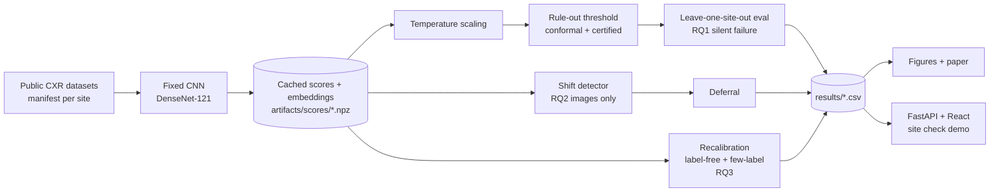

# TB-Recertify — Implementation Plan

**Project:** When Does a TB Rule-Out Guarantee Survive a New Hospital?
**Status:** research prototype · public data only · no clinical validation · not a medical device
**Plan written:** 2026-11-15 · **Week 1 starts:** Mon 2026-11-16 · **Length:** 10 weeks at ~12–15 h/week (stretch or compress to fit your submission date)

**Current status lives in [PROGRESS.md](PROGRESS.md).** The checkboxes below are the roadmap, not the status.

Companion files: [STUDY_TRACK.md](STUDY_TRACK.md) (what to learn each week + coding-round drills) · [INTERVIEW_PREP.md](INTERVIEW_PREP.md) (how to talk about this project)

---

## 0. Read this first: five things that change the plan

These came out of checking your machine and your method. Each one is cheaper to fix now than in week 8.

| # | Finding | What it means for you |
|---|---|---|
| 1 | **The project started from an empty folder** on 2026-11-15. | Scaffolding was day 1; it is now done (see PROGRESS.md). |
| 2 | **Your default Python is 3.14.** You also have 3.13. `python` is not on PATH, only `py`. | Build the venv with `py -3.13`. PyTorch wheels for the newest Python often lag; confirm on pytorch.org before choosing. |
| 3 | **GPU is an RTX 2050 with 4 GB.** Free disk on D: is about 21 GB. | Enough for DenseNet-121 at 224 px, batch 8–16, mixed precision. Not enough for large datasets such as NIH ChestX-ray14. The plan uses a "cache the scores once" design so the GPU is needed for about one week in total. |
| 4 | **Plain split-conformal does not control your "violation rate" metric.** It guarantees sensitivity ≥ target *on average over calibration sets*. Any single calibration set lands below target close to half the time, even with no shift and no bugs. | You need two thresholds: the marginal conformal one and a **certified (PAC) one** that holds with probability 1 − δ. The word "re-certification" in your title really means the second. Phase 3 covers both. |
| 5 | **Sensitivity is calibrated on TB-positive images only**, so the label budget that matters is *positives*, not total images. Below about 9 positives the conformal threshold at 90% is trivial (it rules out nobody). The certified version needs roughly 22 positives at δ = 0.10. | Your grid n = 10, 20, 50, 100 total labels sits mostly under that floor. Report budgets in positives, and report the "trivial threshold" rate. Derive the two floors yourself in Phase 3; it is a ten-line argument and a strong paper paragraph. |

---

## 1. The pipeline in one picture

**The one design decision that makes this feasible on a laptop:** run the CNN over every image exactly once per fold and save logits, labels, image IDs and embeddings to disk. Every experiment after that (thousands of random repeats, bootstraps, label budgets) is NumPy on small arrays and runs on CPU in seconds.

Web-dev analogy: the CNN is a slow upstream API. You call it once, cache the response, and build everything else against the cache.

---

## 2. Timeline

| Week | Dates | Phase | Ships at the end of the week |
|---|---|---|---|
| 1 | Nov 16–22 | P0 Setup + gates · P1 Metrics | Env works, repo on GitHub, dataset audit table, lit-check log, `metrics.py` green |
| 2 | Nov 23–29 | P1 Data | Manifests, splits, `Dataset` class, EDA notebook |
| 3 | Nov 30–Dec 6 | P2 Model + cache | Trained model per fold, cached score files |
| 4 | Dec 7–13 | P3 Calibration + conformal | `calibration.py`, `conformal.py`, validity simulation |
| 5 | Dec 14–20 | P4 Leave-one-site-out (RQ1) | First real result table and figure |
| 6 | Dec 21–27 | P5 Shift detection (RQ2) | Detector power curves, deferral numbers |
| 7 | Dec 28–Jan 3 | P6 Recalibration (RQ3) | Label-budget curves |
| 8 | Jan 4–10 | P7 Degradations | Severity curves; **experiments frozen** |
| 9 | Jan 11–17 | P8 Demo | FastAPI + React "site check", Docker |
| 10 | Jan 18–24 | P9 Paper + report | Preprint draft, viva report, tagged release |

Rule for every week: **nothing counts as done until it has a test, a notebook entry, and a commit.**

---

## 3. Phases

Each task lists what "done" means. Function names are suggestions; the contracts are what matter, and each one is pinned down by a test in `tests/`.

### P0 — Setup and two gates (Week 1, days 1–3)

Setup:

- [ ] Create the venv with Python 3.13, activate it, upgrade pip.
- [ ] Install PyTorch with CUDA using the exact command from the pytorch.org selector (Windows, pip, CUDA). Then confirm the GPU is visible from Python.
- [ ] `git init`, add a `.gitignore` that excludes `data/`, `artifacts/`, `.venv/`, and image files. Datasets never go into Git.
- [ ] Make `src/tbshift` installable (`pyproject.toml`, editable install) so tests import it like a real package.
- [ ] `pytest` runs and reports every test as xfail.
- [ ] Create `docs/research_notebook.md`, `docs/bugs_log.md`, `docs/reading_log.md` with a dated first entry each.
- [ ] Push to a private GitHub repo.

**Gate A — literature check (do not skip, do not delegate).** Your novelty claim is unverified. Two 2026 preprints are close to this idea (one on TB conformal deferral, one on retinal conformal under site shift), and preprints are not peer reviewed.

- [ ] Find and read both. Log them in `reading_log.md`.
- [ ] Search arXiv, medRxiv, Google Scholar and Semantic Scholar with at least: `conformal tuberculosis chest x-ray`, `conformal prediction site shift medical imaging`, `sensitivity guarantee distribution shift recalibration`, `label-free recalibration acquisition shift`.
- [ ] Fill a table: paper · what they do · data · what they do **not** do · how you differ.
- [ ] Write one honest sentence stating your contribution. If you cannot, change the angle now (see Risk 5).

**Gate B — dataset audit.** A site is usable only if both classes were collected at that same site.

| Dataset | What I am fairly sure of | Verify before use |
|---|---|---|
| Montgomery County (USA) | 138 images: 80 normal, 58 TB. One site. | Download source, licence text, citation required |
| Shenzhen (China) | 662 images: 326 normal, 336 TB. One site. | Same as above |
| TBX11K | About 11k images with healthy / sick-non-TB / TB groups | Are per-image hospital IDs available? Are test labels public? Licence |
| DA / DB (New Delhi) | Two small sets from one institute, different machines | Still downloadable? Exact counts, licence |
| Belarus TB portal | TB-positive only | **Cannot be a site on its own** (one class) |
| Kaggle "TB Chest X-ray Database" style merges | TB and normal images come from different sources | **Do not use as a site.** The model can learn "which hospital" instead of "TB". Keep it as your shortcut-learning cautionary example |

- [ ] Complete the table in `docs/dataset_audit.md` with access date, URL, licence, counts, and same-site check.
- [ ] Decide the site list. **Two sites means two folds; aim for three or four.** If you end with two, the paper becomes a carefully framed case study plus controlled degradations. That is still a legitimate paper, but say so plainly.

### P1 — Metrics and data (Weeks 1–2)

`metrics.py`:

- [ ] Confusion counts, sensitivity, specificity from labels and a threshold.
- [ ] AUC written by hand using ranks. Test: matches scikit-learn on random data.
- [ ] ECE with equal-width bins. Test: near zero on synthetic perfectly calibrated data, large on overconfident data.
- [ ] Bootstrap confidence interval, resampling within each class. Test: interval narrows as n grows.
- [ ] Violation rate over repeats.

`data/`:

- [ ] One manifest CSV per site: path, label, site, patient ID if available, split.
- [ ] Deterministic, stratified splits from a seed: train / calibration / test. Test: no file or patient appears in two splits; same seed gives the same split.
- [ ] `Dataset` class: grayscale to 3 channels, resize, normalise.
- [ ] EDA notebook: counts per site and class, image sizes, intensity histograms, a grid of samples.
- [ ] Sanity experiment: train a tiny classifier to predict **site** from the image. It will be near-perfect. Write down why that matters.

### P2 — Model and score cache (Week 3)

- [ ] Step A: frozen ImageNet DenseNet-121 as a feature extractor plus logistic regression on the features. Fast, and a baseline you can explain line by line.
- [ ] Step B: fine-tune with mixed precision, small batch, early stopping on the source validation split.
- [ ] Sanity test: the model can overfit 8 images to near-zero loss. If not, the training loop is broken.
- [ ] Config-driven runs (YAML): every result folder stores the config, the seed and the Git commit.
- [ ] Write `artifacts/scores/<fold>/<site>_<split>.npz` holding logits, labels, IDs, embeddings.
- [ ] From here on, experiments load only these files.

### P3 — Calibration and the rule-out threshold (Week 4)

`calibration.py`:

- [ ] Temperature scaling: one parameter fitted by minimising NLL on source calibration data. Reliability diagram before and after.
- [ ] Think first: does temperature scaling change AUC, or the sensitivity you get from a rank-based threshold? Write your prediction in the notebook, then test it.

`conformal.py`:

- [ ] Marginal threshold: from TB-positive calibration scores only, pick the cut-off below which you "rule out", such that a new TB case from the same distribution scores above it with probability ≥ 1 − α. Derive which order statistic to use; do not copy it.
- [ ] Certified threshold: same idea, but the promise "sensitivity ≥ 1 − α" must hold with probability ≥ 1 − δ over calibration sets. Hint: the number of misses is binomial.
- [ ] Explicit behaviour when there are too few positives (return the trivial threshold and flag it).
- [ ] **Validity simulation** (most important test in the repo): on synthetic data with no shift, 1,000 repeats. Mean sensitivity of the marginal threshold ≥ 1 − α. Violation rate of the marginal threshold: record it and explain it. Violation rate of the certified threshold ≤ δ.
- [ ] Derive the two label floors from Finding 5 and check them in simulation.

### P4 — Leave-one-site-out, RQ1 (Week 5)

- [ ] `experiments/loso.py`: for each held-out site, train on the others, calibrate on source calibration data, evaluate on the unseen site.
- [ ] **In-distribution control first**: same pipeline, test split from the source sites. The guarantee must hold here. If it does not, you have a bug, not a finding.
- [ ] Methods: M0 fixed threshold, M1 source conformal (marginal), M1c source certified.
- [ ] Many random calibration/test resplits (200+). Cheap because of the cache.
- [ ] Output one tidy CSV: fold, method, α, repeat, sensitivity, specificity, threshold. Figures are generated from the CSV only.

### P5 — Shift detection and deferral, RQ2 (Week 6)

`shift.py`:

- [ ] Detector 1: two-sample test on the score distribution (source vs a batch of unlabelled target images).
- [ ] Detector 2: on embeddings, either MMD or a "domain classifier" (can a simple model tell source from target? its AUC is the statistic).
- [ ] Power vs batch size (10, 20, 50, 100, 200). False-alarm rate on same-site batches.
- [ ] Deferral rule: detector fires, so the site gets no automatic rule-outs. Report % deferred.
- [ ] The question that matters: **does the detector fire when the guarantee actually breaks**, or does it fire on harmless shift too? Plot detector statistic against achieved sensitivity.

### P6 — Recalibration and re-certification, RQ3 (Week 7)

`recalibration.py`:

- [ ] M2 label-free: map the target score distribution onto the source one by quantile matching, then reuse the source threshold. Confirm which paper "UPA" refers to in your notes and read it (I believe it is unsupervised prediction alignment, Roschewitz et al. 2023; verify).
- [ ] Stress test: resample the target to change TB prevalence. Quantile matching assumes the class mix is the same. Show where it breaks.
- [ ] M3 few-label: draw n labelled target images, recompute the threshold, repeat 500+ times. Report violation rate, specificity, trivial-threshold rate, and the number of positives actually drawn.
- [ ] Headline figure: violation rate and specificity against label budget, with the analytic floor drawn as a vertical line.

### P7 — Simulated degradations (Week 8)

`degradations.py`:

- [ ] Gaussian noise, blur, JPEG compression, contrast/gamma, each at 5 severities.
- [ ] Tests: severity 0 is identity; shape, dtype and value range preserved; seeded noise is reproducible.
- [ ] Apply to **in-distribution** test images, so the only thing that changed is the degradation. Curves: sensitivity, detector statistic, and recalibration benefit against severity.
- [ ] **Freeze experiments at the end of this week.** New ideas go into "Future work".

### P8 — Demo (Week 9, time-boxed to 5 days)

This is your comfort zone, which makes it the easiest place to lose two weeks. It is the smallest part of the grade and of the paper.

- [ ] Backend: `GET /health`, `POST /site-check` (batch of images or scores in, shift statistic and a verdict out: guarantee plausible / recalibrate / defer), `GET /results/{experiment}`.
- [ ] Model loaded once at startup, CPU inference, Pydantic schemas, routers thin, logic in `services/` calling `tbshift`.
- [ ] Frontend: Site Check page (upload, verdict card, source-vs-site score histogram), Results page, Limitations page.
- [ ] Permanent banner: research prototype, not for clinical use. No real patient uploads.
- [ ] `docker compose up` starts both.

### P9 — Paper, report, viva (Week 10)

- [ ] One command regenerates every table and figure from cached scores.
- [ ] Paper skeleton: Introduction, Related work (from Gate A), Method, Experiments, Results, Limitations, Conclusion.
- [ ] Figures: F1 pipeline · F2 achieved sensitivity per held-out site against target · F3 detector power vs batch size · F4 violation rate vs label budget · F5 degradation curves. Tables: T1 datasets · T2 main results.
- [ ] Limitations written before the abstract.
- [ ] Ask your supervisor about venue and authorship before posting a preprint.
- [ ] Tag a release, write the README quick-start, record a 2-minute demo video.

---

## 4. Risks

| # | Risk | Mitigation |
|---|---|---|
| 1 | Only two verified sites | Gate B in week 1; degradations act as controlled extra "sites"; frame honestly |
| 2 | Tiny positive counts (Montgomery has 58 TB) so confidence intervals are wide | Always report intervals; many repeats; never quote a point estimate alone |
| 3 | Marginal vs certified guarantee confusion | Phase 3 simulation; define "violation" precisely in the paper |
| 4 | Shortcut learning from mixed-source data | Same-site rule; site-classifier sanity check; border and text-marker inspection in EDA |
| 5 | Idea already published | Gate A; fallback angles: the label-floor analysis, detector-vs-harm mismatch, or a reproducibility study of the close preprints |
| 6 | 4 GB GPU / out-of-memory errors | 224 px, batch 8, mixed precision, score cache; Colab as backup |
| 7 | Demo eats the schedule | 5-day box in week 9, after experiments are frozen |
| 8 | Leakage (tuning anything on the target test set) | Split tests; temperature and thresholds fitted only on calibration splits; test split touched once per experiment |

---

## 5. Working rules

1. One branch per phase, small commits, message says what and why.
2. Write the test before or alongside the function. A failing test is a to-do list.
3. Every experiment run is logged in `research_notebook.md`: date, question, config, result, what you conclude, what you do next.
4. Every bug that costs more than 20 minutes goes in `bugs_log.md`: symptom, cause, how you found it, how to catch it faster next time.
5. No number goes in the paper unless a script in the repo produces it.
6. Seeds everywhere. Same config plus same seed gives the same CSV.
