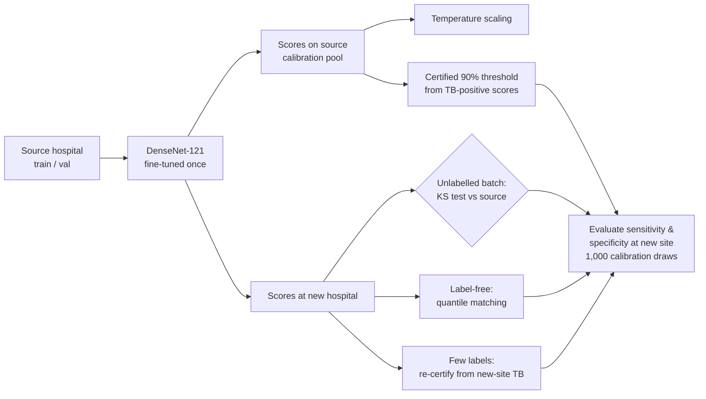
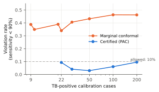
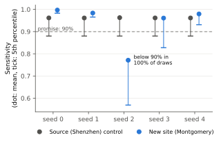
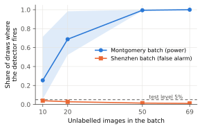
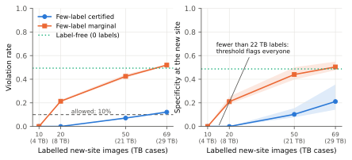
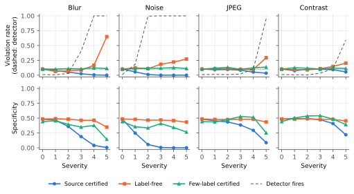

# Does a Certified Tuberculosis Rule-Out Threshold Survive a New Hospital? Silent Failure, Label-Free Detection and Few-Label Re-Certification

**Adarsh Gupta**¹ · *[Supervisor name, if they agree to co-author]*¹

¹ *[Department, Institution]*

> **Draft status (2026-11-16).** First full draft. Every table between `<!-- table:… -->` markers and every figure is regenerated by `python -m tbshift.experiments.paper_assets`; do not edit those tables by hand. Items marked **[VERIFY]** cite work that has so far been read only as an abstract or README (see `docs/reading_log.md`); read it before submission. Venue, length limit and authorship are still to be agreed with the supervisor.

---

## Abstract

Chest X-ray models for tuberculosis (TB) are increasingly proposed as rule-out tools: images scoring below a threshold are cleared, the rest are referred for testing. Conformal methods can choose that threshold so that sensitivity is at least 90% with a stated confidence, but the guarantee assumes the deployment site looks like the calibration site. We measure how this guarantee behaves when a DenseNet-121 trained and certified at one hospital (Shenzhen, China; 662 images) is used at another (Montgomery County, USA; 138 images). We report the guarantee as a *violation rate*: the share of 1,000 random calibration sets for which measured sensitivity at the new site falls below 90%. At the source, the certified threshold violated in 5.4–6.9% of draws for each of five training seeds, within its 10% budget. At the new site, four seeds kept sensitivity but cleared only 5–34% of healthy people, while one seed, indistinguishable at the source and with an ordinary new-site AUC (0.847), fell to 77% sensitivity and violated in every draw. A label-free two-sample test on 50 unlabelled new-site images detected the shift for every seed, so it could not single out the failing model. Moving the threshold without labels (quantile matching) violated in 27–80% of draws. Re-certifying from about 29 labelled TB cases at the new site held violation at 11–13% for all ten trained models, at a cost in specificity. Controlled image degradations reproduced the pattern: the certified promise held, specificity collapsed, and a reduced-contrast shift went largely undetected. We conclude that a source-site sensitivity certificate should not be carried to a new hospital without at least the roughly 22 TB-positive labels needed to re-certify it there. Code is public; the NLM images are not redistributed.

---

## 1. Introduction

Tuberculosis screening programmes that use chest X-rays need a decision, not a probability. A common design is *rule-out*: an automated reader clears images that are very unlikely to show TB, and everything else goes on to confirmatory testing. For such a tool the most important number is sensitivity, the share of TB cases that are not cleared. Missing TB is the costly error.

Split conformal prediction offers a way to set the rule-out threshold so that sensitivity is guaranteed, under an exchangeability assumption, using only a held-out set of TB-positive calibration images [Angelopoulos & Bates 2021; Vovk 2012]. A stronger, *certified* (PAC-style) version guarantees that the threshold reaches the target sensitivity with high probability over the calibration set, not only on average [Vovk 2012; Bates et al. 2021]. Both guarantees are statements about cases drawn from the same distribution as the calibration data. A model trained and calibrated at one hospital is, however, usually deployed at another, with different patients, scanners and image processing. Deep chest X-ray models are known to generalise unevenly across hospitals and to exploit site-specific shortcuts [Zech et al. 2018; DeGrave et al. 2021; Geirhos et al. 2020], and conformal coverage in medical imaging is known to break under domain shift [Mehrtens et al. 2025, **VERIFY**].

This paper asks three practical questions about a TB rule-out threshold certified at one hospital:

- **RQ1.** How often does the 90% sensitivity promise silently fail at an unseen hospital?
- **RQ2.** Can the shift be detected from unlabelled images, and does detection tell us whether the promise failed?
- **RQ3.** How few labelled images from the new hospital restore the promise?

We hold the model fixed and change only the threshold, because a hospital adopting a tool can usually relabel a few cases but cannot retrain the network. Our contributions are empirical:

1. A leave-one-site-out evaluation that reports the guarantee as a **violation rate over calibration sets**, separating the marginal conformal promise from the certified one.
2. Evidence across **five training seeds** that whether the certified promise survives the move depends on the training run, and that nothing visible at the source (control violation rate, AUC) predicts it.
3. A head-to-head of five threshold strategies with the model fixed: fixed threshold, source conformal, label-free quantile matching, detect-and-defer, and few-label re-certification, with the label budget counted in TB positives and the **label floor** (22 positives at α = δ = 0.10) made explicit.
4. Controlled image degradations showing that "the score distribution changed" and "the promise broke" are different events.
5. An open-source pipeline and a small web demo that turns the findings into a site-level decision rule.

We do not propose a new algorithm. The methods are standard; the contribution is a careful measurement of when they can be trusted in this clinical setting.

## 2. Related work

**Conformal prediction and its guarantees.** Split conformal prediction gives marginal, finite-sample coverage under exchangeability [Angelopoulos & Bates 2021]. Training-conditional (PAC) variants bound the probability that a particular calibration set yields a threshold below target [Vovk 2012]; risk-controlling prediction sets generalise this to other losses [Bates et al. 2021]. Weighted conformal prediction restores coverage under covariate shift when the likelihood ratio is known or estimable [Tibshirani et al. 2019].

**Conformal prediction under site shift in medical imaging.** Mehrtens et al. [2025, **VERIFY**] report that conformal coverage holds in-distribution but fails under domain shift in histopathology and that recalibration on target data is required. Cross-site studies in retinal imaging report similar needs for site-specific calibration [**VERIFY**: reading log C6, R1–R3]. The closest work we found is a TB triage system by Aditya [2026, **VERIFY**] that combines a DenseNet-121, calibrated probabilities, conformal "non-TB / defer" outputs, image-quality checks and external testing on cohorts from India and Pakistan. From its public README it does not appear to study few-label re-certification or whether label-free detection identifies failures; *this must be confirmed by reading the preprint in full before submission.*

**Label-free adaptation and shift detection.** Unlabelled target data can be used to recalibrate conformal predictors [Yilmaz & Heckel 2022, **VERIFY**] or to realign prediction distributions after acquisition shift [Roschewitz et al. 2023, **VERIFY**]. Two-sample tests on model outputs or representations are simple, strong shift detectors [Rabanser et al. 2019]. Our label-free arm (quantile matching) and detector (KS test on scores, domain classifier on embeddings) are simple members of these families.

**Few-label adaptation for TB.** Biswas et al. [2026, **VERIFY**] adapt a DenseNet across TB datasets with a few labelled target images and report accuracy. We instead keep the model fixed, adapt only the threshold, and evaluate a sensitivity guarantee rather than accuracy.

**Shortcuts and site effects in chest X-rays.** Chest X-ray models can identify the hospital and exploit markers and acquisition differences [Zech et al. 2018; DeGrave et al. 2021]. We check for such shortcuts in our two sites (Section 5.6).

## 3. Data

We use the two public NLM TB chest X-ray sets [Jaeger et al. 2014; Candemir et al. 2014]. In each, TB and normal images come from the same programme and capture process, so a model cannot separate the classes by recognising the source. Patient-level splits are stratified by class (60/10/15/15% train/validation/calibration/test, seed 0) and fixed for all experiments.

**Table 1.** Datasets. Ages in years; "Male" is the share of male patients.

<!-- table:t1 -->
| Site | Origin | Images | TB | TB share | Mean age (TB / normal) | Male (TB / normal) | Split train/val/cal/test |
|---|---|---|---|---|---|---|---|
| Shenzhen | Shenzhen No. 3 People's Hospital, China | 662 | 336 | 51% | 37.7 / 33.1 | 68% / 68% | 397/67/99/99 |
| Montgomery | Montgomery County TB programme, USA | 138 | 58 | 42% | 48.1 / 34.3 | 64% / 32% | 83/14/21/20 |
<!-- /table:t1 -->

Montgomery's 58 TB cases make it a small evaluation site, and it cannot serve as a calibration source on its own: its calibration-plus-test pool holds too few TB cases to certify a threshold (Section 4.2). We therefore report the Shenzhen → Montgomery direction as the main result and the reverse direction only for model quality. The NLM terms do not allow redistribution, so images, manifests and per-image outputs stay private; only code and aggregate numbers are published.

## 4. Method

**Figure 1.** Pipeline. The model is trained once per site and seed and then frozen; only the threshold changes.

### 4.1 Model

Images are converted to 8-bit grayscale, centre-cropped to a square (crop rather than pad, because the two orientations are unevenly distributed between classes at Montgomery), resized to 512 px once, and to 224 px for the network, with ImageNet normalisation. We fine-tune an ImageNet-pretrained DenseNet-121 [Huang et al. 2017] with a single-logit head: two epochs training only the head (learning rate 10⁻³), then up to 25 epochs of the full network (AdamW, learning rate 10⁻⁴, weight decay 10⁻⁴, batch 16, mixed precision), keeping the epoch with the best validation AUC (patience 5). Augmentation is mild (±5° rotation, 3% translation, 0.95–1.05 scale, ±10% brightness and contrast) and excludes horizontal flips, which would mirror anatomy and side markers. A frozen-feature baseline (ImageNet features + logistic regression) is reported for reference. Each configuration is trained with five seeds (0–4) that change only training randomness (head initialisation, batch order, augmentation); data splits are identical.

### 4.2 Calibration and rule-out thresholds

An image is *ruled out* if its logit is below a threshold τ. Sensitivity is P(score ≥ τ | TB), so only TB-positive calibration scores s₍₁₎ ≤ … ≤ s₍ₙ₎ are needed, and the threshold does not depend on TB prevalence. With target miss rate α = 0.10 (sensitivity ≥ 90%):

- **Marginal (split conformal):** τ = s₍ₖ₎ with k = ⌊α(n + 1)⌋. Sensitivity is at least 1 − α on average over calibration sets and new cases. A single calibration set can fall short.
- **Certified (PAC):** τ = s₍ₖ₎ with k the largest integer such that P(Binomial(n, α) ≤ k − 1) ≤ δ. Then P(sensitivity(τ) ≥ 1 − α) ≥ 1 − δ over calibration sets. Proof sketch: sensitivity of s₍ₖ₎ falls below 1 − α exactly when fewer than k calibration scores lie below the true α-quantile of TB scores, and that count is Binomial(n, α). We use δ = 0.10.

Both assume exchangeability between calibration and future cases. When n is too small no non-trivial threshold exists and the only honest answer is to rule out nobody. The **label floor** is 9 TB positives for the marginal threshold and **22** for the certified threshold at α = δ = 0.10. Temperature scaling [Guo et al. 2017] is fitted on the calibration set for reporting calibrated probabilities; it is monotone and does not change which images are ruled out.

### 4.3 Evaluation protocol and the violation rate

For each trained model we pool the source site's calibration and test images (198 at Shenzhen, 100 TB). In each of 1,000 draws a class-stratified half (≈50 TB) calibrates the threshold, the other half serves as the in-distribution **control**, and all 138 Montgomery images are the **new site**. The **violation rate** is the share of draws in which measured sensitivity is below 90%. For a certified threshold the guarantee implies a violation rate of at most δ = 10% in-distribution, up to the sampling noise of the finite evaluation set. We also report mean sensitivity, its 5th percentile across draws, and mean specificity.

### 4.4 Label-free shift detection (RQ2)

The new site is split, stratified by class, into an **adaptation half** (69 images, 29 TB), the only data any method may see, and an **evaluation half** (69 images), on which every method is scored. A two-sample Kolmogorov–Smirnov test compares an unlabelled batch of B adaptation images with the unlabelled source half (level 5%). *Power* is the share of draws in which it fires on a new-site batch; the *false-alarm* rate uses a same-size source batch instead. As a second view, a cross-validated logistic-regression domain classifier tries to separate source from new-site images using the model's 1,024-dimensional embeddings.

### 4.5 Threshold strategies (RQ3)

All aim at 90% sensitivity with the model fixed:

1. **Source certified:** no change (the RQ1 baseline).
2. **Label-free (quantile matching):** if the source threshold rules out a fraction q of unlabelled source images, rule out the same fraction q of the unlabelled adaptation half.
3. **Detect and defer:** if the KS test fires on the adaptation half, rule out nobody.
4. **Few-label marginal / certified:** label B randomly chosen adaptation images (B = 10, 20, 50, 69) and recompute the marginal or certified threshold from the TB positives among them.

### 4.6 Controlled degradations

To separate "the image changed" from "the hospital changed", we degrade held-out Shenzhen images (same patients, same model) with Gaussian noise, Gaussian blur, JPEG compression and reduced contrast at five severities each. Thresholds are calibrated on a clean half and every method is scored on a degraded quarter it never saw (1,000 draws; same strategies as Section 4.5, with about 25 TB labels for the few-label arm). Re-scoring the clean images reproduced the cached scores to within 0.004 logits.

## 5. Results

### 5.1 In distribution, the certified threshold behaves as designed

On synthetic scores with known true sensitivity (5,000 calibration sets per size), the marginal threshold reaches 90% on average but a single calibration set misses the target 34–46% of the time; the certified threshold keeps the violation rate at or below 10% for every calibration size from 22 positives upward (Figure S1). On real data the same holds at the source: across all five Shenzhen-trained seeds the certified threshold violated in 5.4–6.9% of control draws, the marginal threshold in 35–37%, and the default P(TB) ≥ 0.5 rule in 14–100%.

**Figure S1.** Violation rate of the marginal and certified thresholds against the number of TB-positive calibration cases, synthetic scores without shift. Below 9 (marginal) or 22 (certified) positives no non-trivial threshold exists.

### 5.2 RQ1: whether the promise survives depends on the training run

**Table 2.** Trained on Shenzhen (no corner mask), certified 90% threshold, evaluated at Montgomery; 1,000 calibration draws per seed. *Control viol.* is measured on held-out Shenzhen images. *Label-free* and *Few-label* columns are scored on the Montgomery evaluation half (Section 4.4); few-label uses all 69 adaptation images (29 TB).

<!-- table:t2 -->
| Seed | Source AUC | New-site AUC | Control viol. | New-site viol. | Sens. | Spec. | Label-free viol. | Few-label viol. (69 labels) | Few-label spec. |
|---|---|---|---|---|---|---|---|---|---|
| 0 | 0.914 | 0.871 | 0.066 | **0.000** | 0.997 | 0.053 | 0.271 | 0.114 | 0.355 |
| 1 | 0.935 | 0.842 | 0.057 | **0.001** | 0.984 | 0.125 | 0.761 | 0.114 | 0.159 |
| 2 | 0.916 | 0.847 | 0.054 | **1.000** | 0.771 | 0.717 | 0.410 | 0.132 | 0.157 |
| 3 | 0.909 | 0.839 | 0.064 | **0.112** | 0.961 | 0.337 | 0.517 | 0.133 | 0.242 |
| 4 | 0.917 | 0.843 | 0.069 | **0.043** | 0.980 | 0.145 | 0.509 | 0.114 | 0.142 |
<!-- /table:t2 -->

**Figure 2.** Achieved sensitivity of the certified threshold per training seed, at the source (control) and at the new site. Dots: mean over 1,000 calibration draws; ticks: 5th percentile.

The five seeds are equally good by every source-side measure: source-test AUC 0.909–0.935, control violation 5.4–6.9%, and new-site AUC 0.839–0.871 (Table 2). At Montgomery they split into two failure modes (Figure 2):

- **Four seeds keep sensitivity and lose usefulness.** Montgomery scores sit higher than Shenzhen scores, so TB cases stay above the threshold (mean sensitivity 0.96–1.00) but so do most healthy people: the threshold clears only 5–34% of them, against 47–73% at the source. The safety promise holds; the screening tool becomes nearly useless.
- **One seed (seed 2) loses sensitivity silently.** Its threshold catches 77% of TB at Montgomery, below the 90% promise in all 1,000 draws. At the source it is indistinguishable from the others (control violation 5.4%), and its new-site AUC (0.847) is close to the five-seed mean (0.849).

Ranking quality does not determine threshold transfer: AUC measures how well TB and normal scores are separated, not where the new site's TB scores fall relative to a threshold learnt elsewhere. A study run with one seed would have reported either "the promise never fails" (seed 0) or "the promise always fails" (seed 2).

### 5.3 RQ2: the shift is easy to detect, but detection does not identify failure

**Figure 3.** KS detector firing rate on unlabelled batches from Montgomery (power) and from Shenzhen (false alarm), Shenzhen-trained models without mask; line: mean over five seeds, band: range.

With 50 unlabelled new-site images, the KS test fired in 99–100% of draws for every seed, at a false-alarm rate of 1–2% (Figure 3). The embedding domain classifier separated the two sites perfectly (seed 0 model: cross-validated AUC 1.000, against 0.52 for source versus source). The shift is therefore obvious. What the detector cannot do is say whether it matters: it fires for the four seeds whose sensitivity was preserved and for the one whose sensitivity failed. At small batches it fired more often for the failing seed (98% at 20 images versus 52–75% for the others), a hint that larger score shifts are both more detectable and more dangerous, but not a test. A **detect-and-defer** policy that rules out nobody once the test fires is safe (0% violation) but abandons automation entirely.

### 5.4 RQ3: about 22–29 labelled TB cases restore the promise; label-free repair does not

**Figure 4.** Violation rate (left) and specificity (right) at Montgomery against the number of labelled Montgomery images, Shenzhen-trained models without mask; line: mean over five seeds, band: range. The mean number of TB cases among the labelled images is shown under each budget.

Quantile matching without labels recovered specificity (mean 0.49) but broke the sensitivity promise in 27–76% of draws without the corner mask and 31–80% with it (Table 2, Figure 4). It assumes TB and normal scores move together and that prevalence is unchanged; Montgomery has fewer TB cases (42%) than Shenzhen (51%).

Few-label re-certification behaves as the label floor predicts. With 10 or 20 labelled images (about 4 or 8 TB) no certified threshold exists and every image is flagged. With 50 labels (about 21 TB) the threshold can be certified only in a minority of draws (it flags everyone in 59–61%). With all 69 adaptation images (29 TB), the certified threshold held violation at 11.4–13.3% for **all ten** trained models (five seeds × two mask settings), including the failing seed 2, with specificity 0.09–0.36. The small excess over 10% is consistent with measuring sensitivity on 29 evaluation TB cases. The marginal few-label threshold, by contrast, violated in about half of all draws at 69 labels, as its average-only promise implies.

### 5.5 Controlled degradations: "different" is not "broken"

**Table 4.** Degraded held-out Shenzhen images (seed 0 model). Violation = sensitivity below 90% across 1,000 draws; *Detector fires* uses about 50 unlabelled degraded images.

<!-- table:t4 -->
| Condition | Certified viol. | Certified spec. | Label-free viol. | Few-label viol. | Few-label spec. | Detector fires |
|---|---|---|---|---|---|---|
| clean | 0.10 | 0.48 | 0.10 | 0.10 | 0.44 | 0.01 |
| blur, severity 3 | 0.02 | 0.19 | 0.09 | 0.11 | 0.35 | 0.41 |
| blur, severity 5 | 0.00 | 0.00 | 0.65 | 0.11 | 0.14 | 1.00 |
| noise, severity 3 | 0.00 | 0.01 | 0.18 | 0.12 | 0.41 | 1.00 |
| jpeg, severity 5 | 0.03 | 0.09 | 0.29 | 0.14 | 0.25 | 0.95 |
| contrast, severity 4 | 0.09 | 0.41 | 0.15 | 0.12 | 0.48 | 0.11 |
| contrast, severity 5 | 0.06 | 0.22 | 0.20 | 0.11 | 0.39 | 0.59 |
<!-- /table:t4 -->

**Figure 5.** Violation rate (top; dashed: detector firing rate) and specificity (bottom) against degradation severity for three threshold strategies.

The certified sensitivity promise survived all 20 degradation settings (violation at most 0.101, within the 10% budget up to evaluation noise), but specificity collapsed under blur and noise, falling to near zero at high severity (Table 4, Figure 5). These degradations compress all scores toward the middle; the certified threshold sits in the low tail of clean TB scores, so compressed normal scores rise above it too. Label-free quantile matching broke sensitivity under heavy blur (65% violation) even though prevalence was unchanged, because blur moves TB and normal scores in opposite directions. Few-label re-certification (about 25 TB labels) kept violation at 0.10–0.14 in every setting. Detection depended on the kind of damage: heavy blur and noise were detected in essentially every draw, but reduced contrast at severity 4 only 11% of the time, while specificity was already falling.

### 5.6 Shortcuts and the corner mask

At Montgomery the top-left image corner, where burned-in markers sit, predicts TB with a cross-validated AUC of 0.895, higher than the upper lung fields (0.727); age and sex alone give 0.742. We therefore also trained every model with the four corners masked.

**Table 3.** Model quality by training site and corner mask, mean (min–max) over five seeds. The frozen-feature baseline has no training randomness.

<!-- table:t3 -->
| Trained on | Corner mask | Source test AUC | New-site AUC | Frozen-feature baseline, new-site AUC |
|---|---|---|---|---|
| Shenzhen | no | 0.918 (0.909–0.935) | 0.849 (0.839–0.871) | 0.842 |
| Shenzhen | yes | 0.925 (0.910–0.933) | 0.811 (0.798–0.830) | 0.788 |
| Montgomery | no | 0.852 (0.812–0.906) | 0.779 (0.714–0.821) | 0.847 |
| Montgomery | yes | 0.842 (0.760–0.885) | 0.737 (0.707–0.754) | 0.759 |
<!-- /table:t3 -->

Masking lowered new-site AUC in 9 of 10 paired comparisons (by 0.037 on average for Shenzhen-trained models and 0.042 for Montgomery-trained models) and did not change any conclusion above. Models trained on Montgomery (83 training images) transferred worse (new-site AUC 0.779 on average, below the frozen-feature baseline's 0.847, so fine-tuning on so few images overfitted to the site), and Montgomery's calibration pool holds only about 8 TB cases per draw, below both label floors, so no threshold can be certified from it.

## 6. Discussion

**What a hospital should do.** The source certificate is a statement about the source. Our results suggest a simple rule, implemented in the accompanying demo: run the label-free test as an alarm; whether or not it fires, do not rely on the source threshold until about 22 TB-positive cases from the new site have been labelled and the threshold re-certified there; and if even a handful of labelled TB cases already shows too many misses (a one-sided binomial test), stop. A test that fires says only that the site is different; a test that stays silent is not evidence of safety, as the reduced-contrast setting shows.

**Why AUC is the wrong reassurance.** Seed 2's failure was invisible to the metrics usually reported. Rule-out deployment depends on the *position* of the new site's TB score distribution relative to a fixed threshold, which AUC ignores and which training randomness changes. Multi-seed reporting is necessary for threshold-transfer claims.

**The cost of safety.** A certified threshold from few labels is conservative; with 29 TB labels it restores sensitivity but clears only 9–36% of healthy people. More labels buy specificity, not safety. This is the trade-off a programme must budget for.

## 7. Limitations

- **Two hospitals, one direction.** Only Shenzhen → Montgomery can be certified; the reverse lacks TB cases. Additional sites (e.g. the New Delhi DA/DB sets) are needed before generalising.
- **Small evaluation set.** Montgomery has 58 TB cases (29 per evaluation half), so each violation rate carries evaluation noise; rates of 11–13% for a 10% guarantee are within that noise but are not proof of validity.
- **Five seeds, one architecture.** One failure in five runs is an existence proof, not a failure rate. Other architectures and more seeds may behave differently.
- **Simulated degradations** are compressive by construction; real acquisition changes that lower TB scores without increasing uncertainty would not be caught by the certified threshold's conservatism (our synthetic "harmful shift" case).
- **Random labelling.** Few-label results assume the labelled cases are a random sample of the new site's cases. Labelling only severe or convenient cases would make the re-certified threshold optimistic.
- **Shortcut signals** exist at Montgomery; masking corners did not remove the site effect, and other shortcuts may remain.
- **Not a clinical evaluation.** Public research datasets, no prospective data, no reader study. The demo is a research prototype.
- **Literature check incomplete.** Several closely related 2025–2026 preprints have been assessed from abstracts only.

## 8. Conclusion

A 90% sensitivity certificate for a TB rule-out threshold held at the hospital where it was issued, and at a second hospital it either stayed safe while becoming nearly useless or failed silently, depending only on the training run. Label-free detection saw the shift every time but could not tell these cases apart, and label-free threshold adjustment was unsafe. About 22–29 labelled TB cases from the new hospital were enough to re-certify the threshold for every model we trained. Certificates for medical rule-out tools should be treated as site-specific and re-issued locally.

---

## Data and code availability

Code, configuration and tests: https://github.com/AdarshXGupta07/X-RAY. The Montgomery County and Shenzhen chest X-ray sets are available from the U.S. National Library of Medicine; their terms do not permit redistribution, so no images, manifests or per-image scores are included. All tables and figures in this paper are regenerated from the cached model scores with `python -m tbshift.experiments.paper_assets --rerun`.

## Ethics

Secondary analysis of public, de-identified datasets released by the U.S. National Library of Medicine for research. No new patient data were collected. *[Confirm with the supervisor whether institutional review is required.]*

## Acknowledgements

We thank the U.S. National Library of Medicine, Montgomery County's TB control programme, and Shenzhen No. 3 People's Hospital for making the datasets available. *[Add funding and supervisor acknowledgements.]*

*[AI-use statement: add one if your institution or venue requires it.]*

## References

*Entries marked **[VERIFY]** have been seen only as an abstract, summary or README; confirm authors, title, venue and the cited claim before submission. Unmarked entries are standard references whose details should still be checked against the published version.*

- Aditya, M. F. (2026). Selective conformal AI architecture for tuberculosis triage [title to confirm]. Research Square preprint, doi:10.21203/rs.3.rs-11034929/v1. **[VERIFY]**
- Angelopoulos, A. N., & Bates, S. (2021). A gentle introduction to conformal prediction and distribution-free uncertainty quantification. arXiv:2107.07511.
- Bates, S., Angelopoulos, A., Lei, L., Malik, J., & Jordan, M. I. (2021). Distribution-free, risk-controlling prediction sets. *Journal of the ACM*, 68(6).
- Biswas, et al. (2026). Few-shot cross-dataset adaptation for tuberculosis detection using DenseNet. arXiv:2608.21427. **[VERIFY]**
- Candemir, S., et al. (2014). Lung segmentation in chest radiographs using anatomical atlases with nonrigid registration. *IEEE Transactions on Medical Imaging*, 33(2), 577–590.
- DeGrave, A. J., Janizek, J. D., & Lee, S.-I. (2021). AI for radiographic COVID-19 detection selects shortcuts over signal. *Nature Machine Intelligence*, 3, 610–619.
- Geirhos, R., et al. (2020). Shortcut learning in deep neural networks. *Nature Machine Intelligence*, 2, 665–673.
- Guo, C., Pleiss, G., Sun, Y., & Weinberger, K. Q. (2017). On calibration of modern neural networks. *ICML*.
- Huang, G., Liu, Z., van der Maaten, L., & Weinberger, K. Q. (2017). Densely connected convolutional networks. *CVPR*.
- Jaeger, S., et al. (2014). Automatic tuberculosis screening using chest radiographs. *IEEE Transactions on Medical Imaging*, 33(2), 233–245.
- Mehrtens, et al. (2025). Pitfalls of conformal predictions for medical image classification. arXiv:2506.18162. **[VERIFY]**
- Rabanser, S., Günnemann, S., & Lipton, Z. C. (2019). Failing loudly: An empirical study of methods for detecting dataset shift. *NeurIPS*.
- Roschewitz, M., et al. (2023). Automatic correction of performance drift under acquisition shift in medical image classification. *Nature Communications*, 14. doi:10.1038/s41467-023-42396-y. **[VERIFY]**
- Tibshirani, R. J., Barber, R. F., Candès, E. J., & Ramdas, A. (2019). Conformal prediction under covariate shift. *NeurIPS*.
- Vovk, V. (2012). Conditional validity of inductive conformal predictors. *Asian Conference on Machine Learning (PMLR 25)*.
- Yilmaz, F. F., & Heckel, R. (2022). Test-time recalibration of conformal predictors under distribution shift based on unlabeled examples. arXiv:2210.04166. **[VERIFY]**
- Zech, J. R., et al. (2018). Variable generalization performance of a deep learning model to detect pneumonia in chest radiographs: A cross-sectional study. *PLOS Medicine*, 15(11), e1002683.
